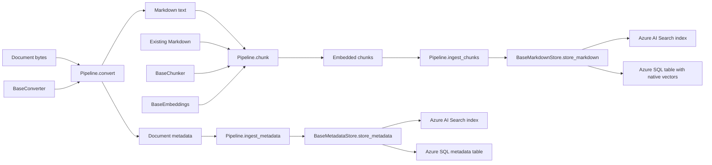

## Overview

`ingestra` composes document conversion, local chunking, embedding generation,
and optional storage. Applications configure the components and own clients,
credentials, SQL connections, and transactions.

Each role chooses one backend independently. Both roles may use Search, both may
use SQL, or either role may use a different backend from the other.

## Components

- [Converter contract](src/ingestra/converter/base.py): async conversion of raw
  bytes into Markdown and document-level metadata.
- [Chunker contract](src/ingestra/chunker/base.py): synchronous structural
  chunking with lossless source text and optional embedding text.
- [Markdown token chunker](src/ingestra/chunker/markdown.py):
  `MarkdownTokenChunker` fills chunks near one token goal, `chunk_size=2048`.
  It counts the complete embedding input, including structural context, and
  chooses a nearby sentence, code-line, or table-row boundary rather than
  enforcing a hard ceiling. Individually oversized units are recursively
  refined. Exact source slices remain non-overlapping, and prose overlap is
  not added. Character-based chunking is not supported.
- [Embedding contract](src/ingestra/embeddings/base.py): asynchronous generation
  of one vector per embedding input.
- [Pipeline](src/ingestra/pipeline.py): preserves chunk order and associates each
  chunk with its exact embedding input, vector, and source page numbers. `convert`
  returns Markdown and metadata; `chunk` accepts Markdown and returns a list of
  embedded chunks without persistence. Applications compose these methods with
  `ingest_metadata` and `ingest_chunks` to invoke independently configured stores.
- [Shared models](src/ingestra/types.py): defines `EmbeddedChunk` and `ChunkResult`
  independently of processing and storage. The pipeline re-exports both models
  to preserve existing imports and avoid circular dependencies. Applications can
  construct `ChunkResult` to group chunks and conversion metadata. `EmbeddedChunk`
  requires embedding text and a vector, while its source page tuple defaults to
  empty; it does not inherit the chunker's optional pre-embedding fields.
- [Markdown storage contract](src/ingestra/store/markdown/base.py):
  `store_markdown(chunks, *, chunk_mapper) -> None`.
- [Metadata storage contract](src/ingestra/store/metadata/base.py):
  `store_metadata(metadata, *, metadata_mapper) -> None`.
- [Azure AI Search provider](src/ingestra/store/azureaisearch.py): implements both
  contracts using one caller-defined index per instance.
- [Azure SQL provider](src/ingestra/store/azuresql.py): implements both contracts
  using one caller-defined table per instance; includes the `AzureSQLVector`
  SQLAlchemy type for native float32 vector columns.

## Reading the Markdown chunker

Read the implementation from its entry point, not from the low-level HTML parsers:

1. [`markdown.py`](src/ingestra/chunker/markdown.py):
   `MarkdownTokenChunker` validates configuration and the source type, and
   resolves the supplied tokenizer or creates its default cl100k_base callable.
   Start at its `chunk` method.
2. [`_token.py`](src/ingestra/chunker/_token.py):
   `_TokenChunker.chunk` is the short orchestration method. It validates
   tokenizer results, parses source units and layouts, locates page markers,
   and emits contiguous source slices near the requested token size.
3. [`_structure.py`](src/ingestra/chunker/_structure.py):
   `_parse_units` recognizes blocks and attaches active headings.
   `_split_layout` identifies preferred sentence, code-line, or table-row
   boundaries and repeatable wrappers. Neither function applies token budgets.
4. Back in [`_token.py`](src/ingestra/chunker/_token.py), `_choose_end` locates
   the token goal across blocks and recursively refines the semantic unit
   surrounding it. `_render` adds context only at the beginning and end of a
   source range, repeating partial table headers and code fences as needed.
   `_heading_context` bounds optional headings so they do not dominate content.
   `_fitting_boundary` uses exponential probing and binary refinement without
   repeatedly tokenizing a huge remaining suffix.

Internal source offsets keep `original_text` slices contiguous and
non-overlapping. Extra headings, fences, and headers affect only the
embedding input. Default tokenizer loading happens only when
`MarkdownTokenChunker` is constructed without a custom callable. The callable
returns an integer token count, using the length of ordinary token IDs for the
default. Tokenizer results are not cached; source positions and page context
are scoped to one document.

## Pipeline ingestion

The pipeline accepts independently optional `markdown_store` and `metadata_store`
constructor arguments. Existing construction with only a converter, chunker, and
embedding generator remains supported. `convert(data)` and `chunk(markdown)`
never invoke stores.

`ingest_chunks(chunks, *, chunk_mapper)` and
`ingest_metadata(metadata, *, metadata_mapper)` independently persist prepared
data through the matching store. Each requires only its own store and mapper,
returns `None`, and never runs conversion, chunking, or embedding. Empty chunk
sequences perform no provider writes; empty metadata still produces a document.

There is no combined ingestion method. Applications choose which processing and
persistence methods to call, their order, and whether to group outputs in
`ChunkResult`. A typical workflow awaits `convert(data)`, `chunk(markdown)`,
`ingest_metadata`, and `ingest_chunks` in that order. Empty chunks skip embedding
and Markdown writes; metadata is stored only when the application requests it.
Store and mapper configuration is checked separately by each persistence method,
not before the application's complete processing workflow.

Component and storage errors propagate unchanged. In the sequence above, no
writes occur if processing fails, and a metadata failure prevents the Markdown
write. A later Markdown failure can leave metadata already persisted. Mapping
validation remains per store call, not across the complete ingestion.

Store callbacks are supplied per invocation and are not retained by the pipeline.
Stores, components, clients, SQL connections, and transactions remain caller-owned.
The pipeline never commits, rolls back, closes clients, or retries operations.
Both SQL roles can share an application-owned transaction; mixed backends cannot
participate in one transaction.

## Independent storage contracts

The two bases provide shared mapping behavior. A provider implements their common
protected `_store_documents(documents)` hook once; it does not duplicate chunk
and metadata mapping or accept a union of unrelated public inputs.

`store_markdown` accepts a sequence of `EmbeddedChunk` values and invokes its
synchronous mapper once per chunk in source order. `store_metadata` accepts a
metadata dictionary and invokes its synchronous mapper once. Callbacks return
complete dictionaries, including keys and any application-defined linking fields.
Neither provider adds fields, generates keys, or regenerates embeddings.

Each operation maps and deep-copies all documents before invoking the provider.
Callback failures propagate before that operation writes anything. This is a
per-call guarantee: a metadata write can already have succeeded before a later
Markdown mapping fails. Empty chunk sequences do not invoke the provider, while
empty metadata dictionaries can still be mapped and stored.

There is no combined `BaseStore`. Applications may invoke stores directly or use
the pipeline's independent persistence methods. Write order, stable keys, retries,
and obsolete-chunk deletion remain application responsibilities.
Successful Search calls finish their uploads; successful SQL calls finish their
statements within the caller's transaction, which still needs to commit.

## Azure AI Search

The constructor accepts a caller-owned async `SearchClient` and one
`SearchIndex` definition. It discovers the schema's key field locally and rejects
schemas without a key. The client must target the index described by the schema.
Construction makes no service requests. Administration clients are not accepted.

The index must already exist. The provider never looks up, creates, changes, or
deletes indexes. Apart from checking nonempty string keys and rejecting duplicate
mapped keys, schema and vector compatibility belong to the caller and service.

The shared write hook uploads at most 1,000 documents per batch and checks for
exactly one successful result per uploaded key. Failed, missing, duplicate, and
unexpected results raise `RuntimeError`; SDK errors propagate. Uploads replace
existing documents with matching keys and do not delete obsolete chunks.

Instances may share an index if their schemas are compatible and keys are
disjoint. Usually each role uses its own index and configured document client.
The provider uploads directly through that client, preserving transport, retry,
and timeout configuration. The caller owns client entry, cleanup, and credentials.
Search does not provide cross-index joins or transactions spanning write calls
and batches.

## Azure SQL

The constructor accepts a caller-owned SQLAlchemy `AsyncConnection` using the
SQL Server dialect and one existing `Table` definition with a primary key.
Async applications normally use the `mssql+aioodbc` dialect and a host-installed
Microsoft ODBC Driver for SQL Server. Construction does not query or provision
the database.

The write hook requires an active transaction and validates all mapped column
names and primary-key values before executing statements. Composite primary keys
are supported. SQLAlchemy quotes identifiers and binds values.

For each row, a primary-key lookup uses `WITH (UPDLOCK, HOLDLOCK)` to retain
update/serializable-range locks until transaction completion. The provider inserts
missing rows or updates supplied non-key fields of existing rows. Omitted fields
on updates remain unchanged. Errors propagate to the caller, who owns rollback
and retry decisions.

`AzureSQLVector(dimensions)` declares `VECTOR(dimensions)` with 1-1,998 float32
elements. It validates finite numeric lists, serializes values as JSON string
parameters for ODBC, and emits `CAST(:parameter AS VECTOR(dimensions))` for native
storage. It does not silently substitute a JSON column on unsupported deployments.
Mappers must include the text and vectors required by their chosen table.

The store does not commit, roll back, or close the connection. Applications should
use `async with engine.begin() as connection` so successful exits persist writes
and failures roll back. Both SQL roles can share a connection and transaction.
Transactions cannot span SQL and Search: a mixed-backend operation can partially
succeed, even when the SQL portion later rolls back.

## Verification

Standard-library `unittest` tests cover processing, independent persistence roles,
shared mapping, SDK serialization through a recording transport, SQL Server
dialect compilation, native vector processing, and failures. Some legacy pipeline
and backend-combination tests still call the removed combined ingestion method;
see the [testing notes](docs/guide.md#tests) for the known failure.
No live Azure resources are required by these tests; live connectivity, server
feature support, and deployment permissions require separate integration verification.
